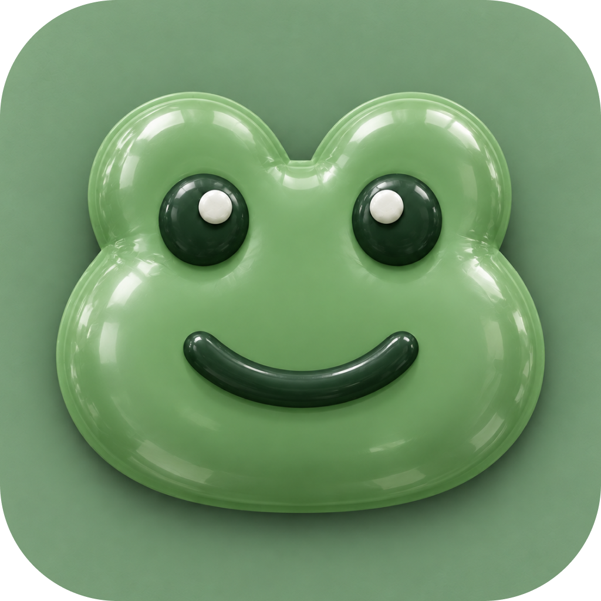
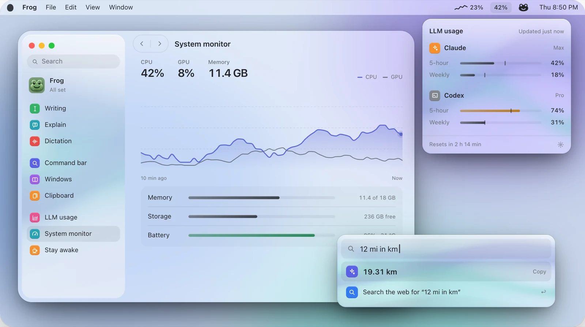
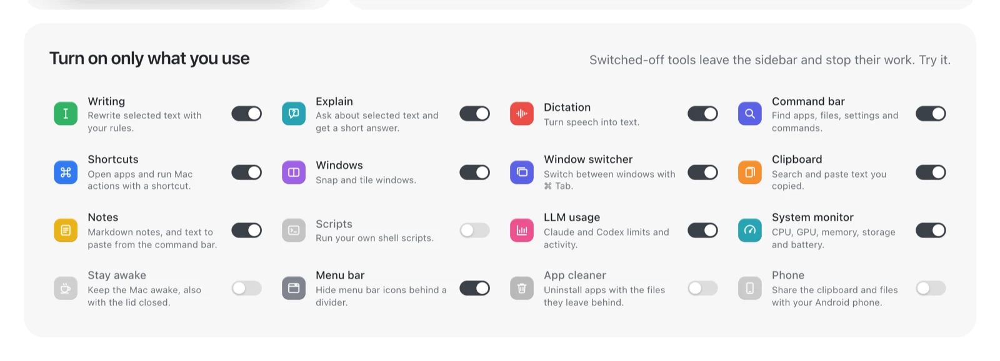
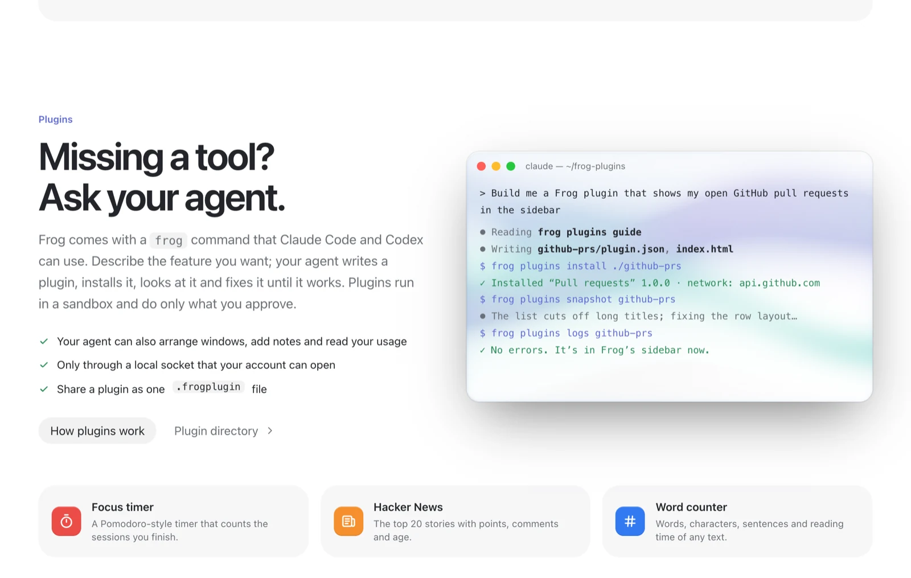
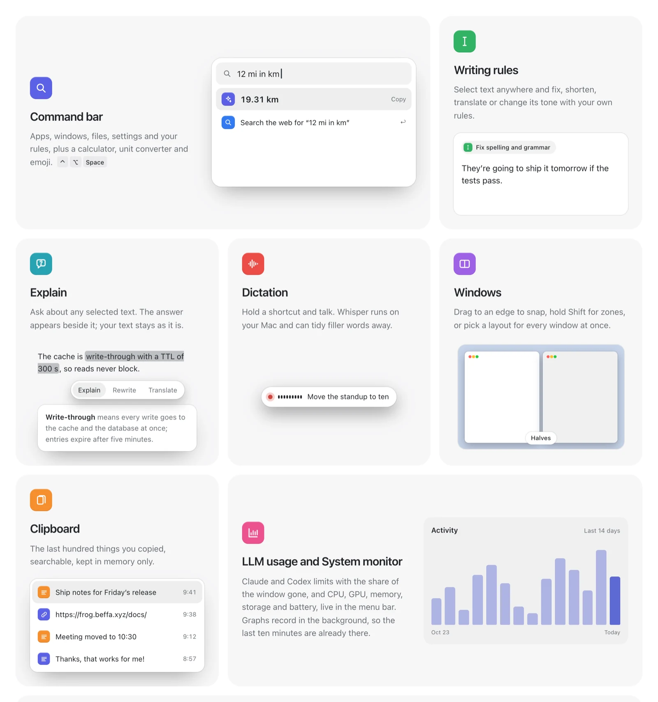
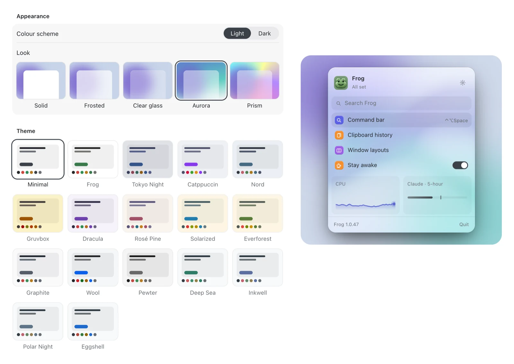

<div align="center">



# Frog

**A plug-and-play platform for your Mac, built to be extended by your AI agent.**<br>
Every feature is a plugin you can switch on or off. Tell your agent what's missing and it builds the next one.<br>
Free and open source. No account, no telemetry.

[](https://github.com/t1llo/frog/releases/latest)
[](https://github.com/t1llo/frog/releases)
[](#install)
[](LICENSE)
[](https://github.com/t1llo/frog/actions/workflows/native.yml)

[**Download for Mac**](https://github.com/t1llo/frog/releases/latest) · [Website](https://frog.beffa.xyz/) · [Plugins](https://frog.beffa.xyz/plugins/) · [Docs](docs/)

<br>

<picture>
  <source media="(prefers-color-scheme: dark)" srcset="docs/media/readme/stage-dark.webp">
  
</picture>

</div>

## A platform, not a pile of apps

Frog is a small harness that lives in the menu bar: one window, one popup, one command bar, one `frog` command, one design. Everything else plugs into it.

- **Plug and play.** Writing, dictation, windows, clipboard, LLM usage and every other tool is a plugin. Switch one off and it leaves the sidebar, stops its work and keeps nothing running. Switch it on again and it's back where you left it.
- **Your agent builds the rest.** Ask Claude Code, Codex, Gemini CLI, pi or OpenCode for the feature you're missing. It builds a complete Frog feature: a page in Frog's design, actions for the command bar and shortcuts, and the system access the feature needs. Then it installs, checks and fixes it, and the feature waits for your review.
- **Honest permissions.** A plugin can do only what its manifest declares and you approved. Frog lists every permission before the first install and asks again when an update wants more.
- **Shareable.** A plugin is a folder. Share it as one `.frogplugin` file, or list it in the signed [directory](https://frog.beffa.xyz/plugins/) that Frog installs from in one click.

<div align="center">
<picture>
  <source media="(prefers-color-scheme: dark)" srcset="docs/media/readme/tools-dark.webp">
  
</picture>
</div>

## Ask for a feature, get a feature

Switch on **Settings → Agents**, then ask in plain words:

```text
> I want Frog to show my open pull requests in the menu bar,
  refresh them every ten minutes and open one with ⌥⌘P.
```

The agent reads `frog plugin guide`, the contract that ships with the app, and uses the `frog` command:

```sh
frog plugin new ~/frog-plugins/pull-requests --with menubar,hotkey,background,settings
frog plugin validate ~/frog-plugins/pull-requests     # checks the manifest, shortcuts and settings
frog plugin install ~/frog-plugins/pull-requests      # waits for your review
frog plugin snapshot io.github.you.pull-requests --popup  # looks at its own work
frog plugin logs io.github.you.pull-requests          # reads its errors and fixes them
```

<div align="center">
<picture>
  <source media="(prefers-color-scheme: dark)" srcset="docs/media/readme/agents-dark.webp">
  
</picture>
</div>

### What a feature can do

A plugin is no longer just a page. Each capability is a permission in `plugin.json`, shown to you before the first install; the ones marked ⚠︎ carry a caution line.

| Permission | The feature can |
| --- | --- |
| `menubar` | Put its own item in the menu bar, with a popup in Frog's style and a live title. |
| `hotkeys` | Run its actions from global shortcuts you can change; keys Frog already uses are refused. |
| `background` ⚠︎ | Start with Frog and keep working with its page closed, reacting to wake, sleep, lock, the app in front and, with `clipboard-read`, new copies. |
| `selection` ⚠︎ | Read and replace the selected text in any app, right after you run one of its actions. |
| `files` ⚠︎ | Read and write files, only inside folders you pick. |
| `frog-actions` ⚠︎ | Use Frog's own actions it names, such as moving windows. |
| `ai` ⚠︎ | Ask the models you set up in Frog, without ever seeing a key. |
| `network` ⚠︎, `scripts` ⚠︎ | Reach the hosts it lists; run its own shell scripts with JSON or streamed output. |
| `clipboard-read` ⚠︎, `clipboard-write`, `notifications`, `links` | The clipboard, notifications with buttons, and opening links. |

Settings come with it: rows in Frog's own controls, and secret ones such as API tokens are kept in the Keychain. Every plugin page gets Frog's theme as CSS variables plus `frog.css`, Frog's buttons, cards, switches and meters, so a feature your agent builds looks like it shipped with Frog. Turning a feature off or removing it takes its menu-bar item, shortcuts, background work, secrets and folder grants with it.

[Focus timer](plugins/focus-timer) shows a whole feature in about 350 lines: a countdown in the menu bar, ⌃⌥⇧F from any app, break reminders with buttons, and settings.

The first install waits for you in **Frog → Community plugins**, with every permission listed. After that, the agent's updates apply at once as long as they ask for nothing new.

More examples in [`plugins/`](plugins/): [Hacker News](plugins/hacker-news) and [Word counter](plugins/word-counter). The full contract is [docs/plugins.md](docs/plugins.md); what agents can do with the `frog` command is in [docs/agents.md](docs/agents.md).

## What ships in the box

<div align="center">
<picture>
  <source media="(prefers-color-scheme: dark)" srcset="docs/media/readme/bento-dark.webp">
  
</picture>
</div>

| Plugin | What it does |
| --- | --- |
| **Writing** | Rewrite selected text with your own rules, each on a shortcut. |
| **Dictation** | Speech to text with local Whisper or Parakeet models. |
| **Explain** | Select text, get an answer in a panel beside it, ask follow-ups, save to Obsidian. |
| **Command bar** | Apps, files, settings, calculations and conversions. |
| **Windows** | Drag-to-snap zones, a layout picker, keyboard halves and thirds, a window switcher. |
| **Clipboard & notes** | Searchable clipboard history, Markdown notes and saved scripts. |
| **LLM usage** | Claude and Codex plan limits, token charts and estimated cost. |
| **System monitor** | CPU, GPU and memory over the last ten minutes, free storage, battery and temperature. |
| **Menu bar & Stay awake** | Hide icons you rarely need; keep the Mac awake for a while. |
| **App cleaner** | Uninstall apps with the files they leave behind, after a review. |
| **Phone** | Your Android phone's clipboard and the Mac's stay in sync both ways, over Wi-Fi or Bluetooth, with the [Frog Companion](companion/android) app. |

Local models run on Apple silicon: Whisper or Parakeet for dictation, Qwen, Llama or Gemma for writing rules. Cloud providers are optional, and their keys stay in Keychain.

## Make it yours

<div align="center">
<picture>
  <source media="(prefers-color-scheme: dark)" srcset="docs/media/readme/looks-dark.webp">
  
</picture>
</div>

Seventeen themes in light and dark, glass with a light that follows the pointer, and plain-text config files. Plugins get the same theme automatically, so what your agent builds looks like the rest of Frog.

## Install

[**Download the latest release**](https://github.com/t1llo/frog/releases/latest), open the DMG and move **Frog.app** to **Applications**. Frog updates itself.

macOS 14 or later, Apple silicon or Intel. Built-in local models need Apple silicon.

## Privacy

- No Frog account, no analytics, no Frog backend.
- Local models never leave your Mac; connected providers are used only when you pick them.
- API keys live in the macOS Keychain; each permission is asked for by the feature that needs it.
- Plugins run sandboxed and reach only the hosts, folders and system features you approved.

Details in [docs/privacy.md](docs/privacy.md).

## Build from source

Requires Xcode with Swift 6.3 or later.

```sh
export DEVELOPER_DIR=/Applications/Xcode.app/Contents/Developer
swift test -c release
make build
open dist/Frog.app
```

Signing and packaging: [docs/development.md](docs/development.md).

## Docs

[Plugins](docs/plugins.md) · [Agents](docs/agents.md) · [Configuration and themes](docs/configuration.md) · [Local models](docs/local-model-sources.md) · [Providers](docs/providers.md) · [Installed AI tools](docs/local-tool-providers.md) · [LLM usage](docs/usage-integration.md) · [Windows](docs/windows.md) · [Stay awake](docs/stay-awake.md) · [App cleaner](docs/cleaner.md) · [Phone protocol](docs/companion-protocol.md) · [Statistics](docs/statistics.md)

## Contributing

Issues and pull requests are welcome. Built a plugin you like? Open an issue with a link to its `.frogplugin` and it can join the [directory](https://frog.beffa.xyz/plugins/).

## License

Copyright © 2026 Tillo Beffa. Frog is open source under the [MIT License](LICENSE).
