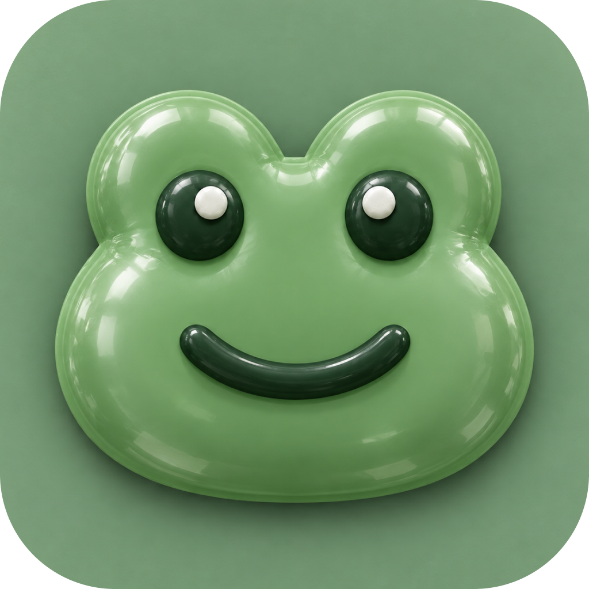
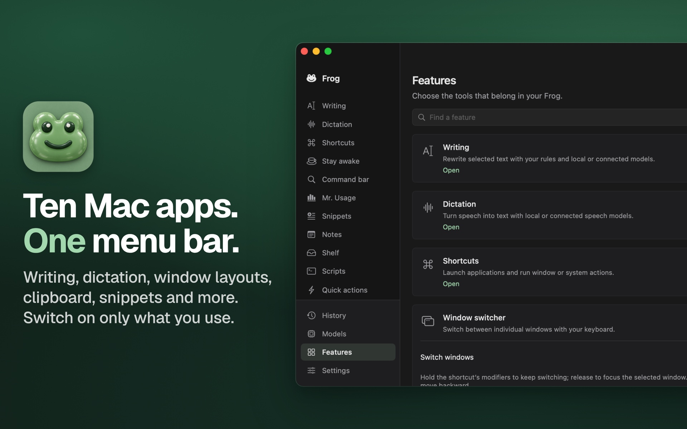
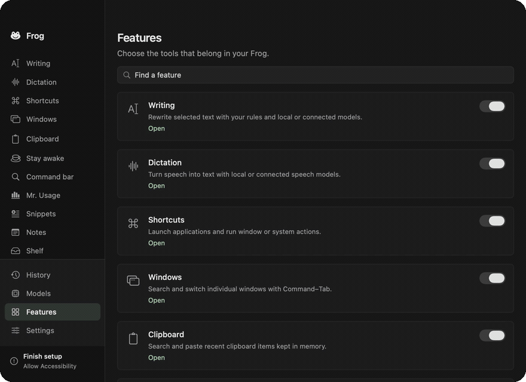

<div align="center">



# Frog

**The Mac menu-bar app your AI agent can extend.**<br>
Ten small Mac apps in one, local models built in, and plugins your agent writes for you.<br>
Free and open source. No account, no telemetry.

[](https://github.com/t1llo/frog/releases/latest)
[](https://github.com/t1llo/frog/releases)
[](#install)
[](LICENSE)
[](https://github.com/t1llo/frog/actions/workflows/native.yml)

[**Download for Mac**](https://github.com/t1llo/frog/releases/latest) · [Website](https://frog.beffa.xyz/) · [Plugins](https://frog.beffa.xyz/plugins/) · [Docs](docs/)

<br>



</div>

## Why Frog

- **Your agent builds the features you're missing.** Ask Claude Code, Codex, Gemini CLI, pi or OpenCode for "a Frog plugin that shows my open pull requests" and it builds one, checks it and installs it for your review. Plugins are sandboxed and ask before they use anything.
- **Local models, on your Mac.** Dictation with Whisper or Parakeet and writing rules with Qwen, Llama or Gemma, all on Apple silicon. Cloud providers are optional, and their keys stay in Keychain.
- **One app instead of ten.** Writing, dictation, command bar, window snapping, clipboard, notes, AI usage limits, system monitor, app cleaner. Switch on only what you use.

<div align="center">

[](docs/media/frog-toolkit.mp4)

</div>

## Plugins, built by your agent

Switch on **Settings → Agents**, then ask:

```text
> Build me a Frog plugin that lists the top Hacker News stories
  and opens one when I click it.
```

The agent uses the `frog` command that ships with the app:

```sh
frog plugin new ~/frog-plugins/hacker-news        # start from a template
frog plugin validate ~/frog-plugins/hacker-news   # validate manifest and files
frog plugin install ~/frog-plugins/hacker-news    # waits for your review
frog plugin snapshot io.github.you.hacker-news    # looks at its own work
```

The first install waits for you in **Frog → Community plugins**, with every permission listed. After that, the agent's updates apply at once while they ask for nothing new. `frog plugin publish` packs a plugin into one `.frogplugin` file and prints its entry for the signed directory, which Frog installs from in one click.

Examples in [`plugins/`](plugins/): [Hacker News](plugins/hacker-news), [Focus timer](plugins/focus-timer), [Word counter](plugins/word-counter). The full contract is in [docs/plugins.md](docs/plugins.md).

The same `frog` command lets agents arrange windows, run your scripts, add notes, read the clipboard history and check your Claude or Codex limits. See [docs/agents.md](docs/agents.md).

## What's inside

| Tool | What it does |
| --- | --- |
| **Writing** | Rewrite selected text with your own rules, each on a shortcut. |
| **Dictation** | Speech to text with local Whisper or Parakeet models. |
| **Explain** | Select text, get an answer in a panel beside it, ask follow-ups, save to Obsidian. |
| **Command bar** | Apps, files, settings, calculations and conversions. |
| **Windows** | Drag-to-snap zones, a layout picker, keyboard halves and thirds, a window switcher. |
| **Clipboard & notes** | Searchable clipboard history, Markdown notes and saved scripts. |
| **Mr. Usage** | Claude and OpenAI plan limits, token charts and estimated cost. |
| **System monitor** | CPU and GPU charts, disk, battery and thermals in the menu bar. |
| **Menu bar & Stay awake** | Hide icons you rarely need; keep the Mac awake for a while. |
| **App cleaner** | Uninstall apps with the files they leave behind, after a review. |
| **Phone** | Share the clipboard and files with your Android phone over Wi-Fi or Bluetooth, through the Frog Companion app. |
| **Plugins** | Your own pages and commands, sandboxed, shared as one file. |
| **Themes** | Eleven themes, including Tokyo Night, and editable config files. |

## Install

[**Download the latest release**](https://github.com/t1llo/frog/releases/latest), open the DMG and move **Frog.app** to **Applications**.

macOS 14 or later, Apple silicon or Intel. Built-in local models need Apple silicon.

## Privacy

- No Frog account, no analytics, no Frog backend.
- Local models never leave your Mac; connected providers are used only when you pick them.
- API keys live in the macOS Keychain; each permission is asked for by the feature that needs it.

Details in [docs/privacy.md](docs/privacy.md).

## Build from source

Requires Xcode with Swift 6.3 or later.

```sh
export DEVELOPER_DIR=/Applications/Xcode.app/Contents/Developer
swift test -c release
make build
open dist/Frog.app
```

Signing and packaging: [docs/development.md](docs/development.md).

## Docs

[Configuration and themes](docs/configuration.md) · [Plugins](docs/plugins.md) · [Agents](docs/agents.md) · [Local models](docs/local-model-sources.md) · [Providers](docs/providers.md) · [Installed AI tools](docs/local-tool-providers.md) · [Mr. Usage](docs/usage-integration.md) · [Windows](docs/windows.md) · [Stay awake](docs/stay-awake.md) · [App cleaner](docs/cleaner.md) · [Statistics](docs/statistics.md)

## Contributing

Issues and pull requests are welcome. Built a plugin you like? Open an issue with a link to its `.frogplugin` and it can join the [directory](https://frog.beffa.xyz/plugins/).

## License

Copyright © 2026 Tillo Beffa. Frog is free software under the [GNU General Public License](LICENSE), version 3 or later.
